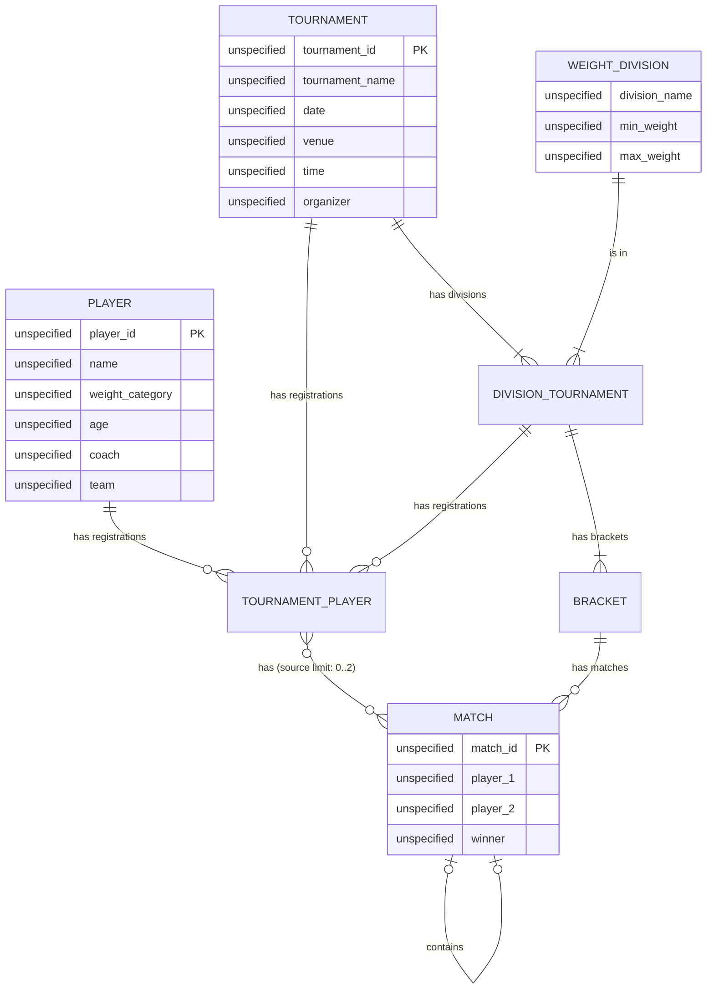

# Arnis Tournament Management System

> **Status:** Initial architecture and requirements draft  
> **Purpose:** A reference document for planning, implementation, and verification.  
> **Important:** This document captures current decisions and open questions. It is not a claim that every rule has been finalized.

## 1. Project overview

Build a web-based arnis tournament management system for Dumaguete Arnis Association (DUMAA). Tournament managers use the private management interface to register players, configure events/tournaments, generate brackets, record results, and control match progression. The public can view a live scoreboard without receiving access to management capabilities.

The system is initially intended for a small number of operators and a modest database, so the architecture should prioritize correctness, maintainability, and simplicity over infrastructure complexity.


## 2. Functional Requirements — Tournament Management System

## 1. Player Management

### FR-01: Register Players
**Actor:** Admin

The system must allow the admin to register players.

- Capture and persist the required player information.
- Validate required fields before saving.
- Prevent invalid registrations according to the defined validation rules.

### FR-02: Manage Registered Players
**Actor:** Admin

The system must allow the admin to manage registered players.

- View and search registered players.
- View individual player details.
- Edit player information.
- Remove or deactivate player registrations as permitted by the tournament's current state.
- Preserve data integrity when a player is associated with an existing tournament, bracket, or match.

## 2. Tournament/Event Management

### FR-03: Manage Tournaments and Events
**Actor:** Admin

The system must allow the admin to create, view, edit, and delete tournaments/events.

- Create a tournament/event with the required information.
- View tournament/event details.
- Update tournament/event information.
- Delete a tournament/event subject to data integrity constraints.
- Manage the tournament's lifecycle and associated data.

## 3. Bracket Generation and Progression

### FR-04: Generate Single-Elimination Brackets
**Actor:** System

The system must automatically generate a single-elimination bracket for each applicable weight division within a tournament.

- Include eligible players registered for the corresponding tournament and weight division.
- Ensure each match has the required participant slots.
- Support byes when the number of eligible players is not a power of two.
- Persist generated matches and their bracket relationships.
- Prevent duplicate bracket generation unless an explicit regeneration workflow is supported.
- Preserve the relationship between tournament, weight division, participants, and matches.

### FR-05: Automatically Progress Brackets
**Actor:** System

The system must automatically advance the winner of a completed match to the appropriate participant slot in the next round.

- Determine the winner from the match's recorded result.
- Identify the next match and the correct participant slot.
- Update the bracket progression when a valid match result is finalized.
- Handle byes according to the bracket rules.
- Prevent progression when a match result is incomplete or invalid.
- Ensure that a match winner is not advanced more than once for the same finalized result.

## 4. Public Scoreboard

### FR-06: Display Public Scoreboard
**Actor:** Public Viewer

The system must provide a publicly accessible scoreboard view.

- Display the relevant match information and current scores.
- Clearly identify the competitors and their respective scores.
- Display the match status where applicable.
- Reflect the latest scoreboard state without requiring a manual page refresh, subject to the chosen real-time update mechanism.

### FR-07: Manage Scoreboard in Real Time
**Actor:** Admin

The system must allow the admin to modify the score of an active match in real time.

- Add points to a competitor's score.
- Deduct points from a competitor's score.
- Validate score modifications against the defined scoring rules.
- Persist score changes.
- Propagate score updates to connected public scoreboard viewers.
- Ensure unauthorized users cannot modify scores.
- Maintain a reliable record of score changes where required for auditing and dispute resolution.

## 5. Business Rules and Constraints

- Each tournament may contain multiple weight divisions.
- Each bracket belongs to a specific tournament and weight division.
- Only eligible players may participate in a generated bracket.
- Each match must belong to the appropriate bracket and round.
- A finalized match result determines bracket progression.
- Score updates and bracket progression must preserve data consistency.
- Administrative operations must enforce appropriate authorization.
- Destructive operations must account for dependent records and existing match results.

## 6. Acceptance Criteria

The implementation is considered functionally complete when:

1. An admin can register, view, edit, and manage players.
2. An admin can create, view, edit, and delete tournaments/events.
3. The system generates a valid single-elimination bracket for each applicable weight division.
4. A public viewer can access the scoreboard without administrative permissions.
5. An admin can add or deduct points and see the updated scores reflected on the public scoreboard.
6. Finalizing a match result automatically advances the winner to the correct next-round match.
7. The system prevents invalid operations from corrupting player, match, score, or bracket data.


## 3. Product boundaries

### In scope for the initial version

- **Admin authentication and authorization:** Admin sign-in and role-based access control for administrative operations.
- **Player management:** Register, view, search, edit, and manage registered players.
- **Tournament/event management:** Create, view, edit, and delete tournaments/events, subject to data integrity constraints.
- **Weight division management:** Organize eligible players by weight division within a tournament.
- **Bracket generation and display:** Automatically generate and display single-elimination brackets for each applicable weight division, including byes when necessary.
- **Match management:** Manage match status, participants, and results.
- **Winner advancement:** Automatically advance the winner of a finalized match to the correct participant slot in the next round.
- **Public bracket and scoreboard views:** Provide publicly accessible, read-only views of tournament brackets, match information, and scores.
- **Live scoreboard management:** Allow admins to add and deduct points from competitors' scores, with changes persisted and reflected on the public scoreboard in real time.
- **Basic audit history:** Record important administrative actions, including score modifications and match-result finalization.
- **Data integrity and validation:** Enforce business rules for player eligibility, tournament associations, match results, score changes, and bracket progression.
- **Automated testing:** Validate player and tournament management, bracket generation, bye handling, score updates, match finalization, and winner advancement workflows.

### Out of scope for the initial version

- Online player registration or self-service player accounts.
- Automated tournament seeding based on rankings or performance statistics.
- Advanced analytics, rankings, and historical performance reports.
- Automated match scheduling and referee assignment.
- Notifications via email, SMS, or third-party messaging platforms.
- Advanced audit reporting and analytics.


### Not decided yet

These are requirements questions, not implementation details to guess:

- Bracketing logic (rules for bracketing players and constraints)
- How divisions are defined: age, weight class, gender category, or other criteria.
- Seeding rules and how byes are assigned.
- How is scoreboard displayed from client ( do admins select from bracket? auto progression? etc. )


## 4. Architecture decisions

### Chosen direction

Use a **modular monolith**:

- **Web application:** Next.js + TypeScript, hosted on Vercel.
- **Database:** Supabase PostgreSQL.
- **Authentication:** Supabase Auth, with manager access controlled by server-side authorization.
- **Realtime updates:** Supabase Realtime for public scoreboard updates.
- **Runtime validation:** Zod schemas at application boundaries.
- **Types:** Supabase-generated database types plus separately defined domain and API types.
- **Testing:** Unit tests for pure domain logic; integration tests for database workflows; end-to-end tests for critical manager and public journeys.

This is a proposed baseline, not a requirement to use every library from day one. Confirm versions and platform limits during implementation.

### Why a modular monolith?

The system has a small number of concurrent managers and a straightforward initial workflow. Separate microservices would add deployment, networking, observability, and consistency costs without a demonstrated need.

Keep the code divided by domain responsibilities so individual modules can be changed and tested independently. A modular monolith does **not** mean putting all logic into one file or allowing every module to access every other module's internals.

### Why Supabase?

Supabase provides managed PostgreSQL, authentication, and realtime capabilities in one platform. PostgreSQL is the durable source of truth for players, registrations, brackets, matches, and results.

Supabase simplifies infrastructure, but it does not remove the need to design constraints, authorization, transactions, or business rules correctly.

### Why TypeScript for both frontend and backend?

Using TypeScript across the web application makes it easier to reuse types and validation definitions. It also lets the domain logic be tested independently of UI components and HTTP handlers.

Sharing a type is not the same as validating input. Browser data is untrusted: validate incoming requests at runtime and apply domain rules on the server.

### Why Next.js Route Handlers initially?

Next.js Route Handlers can provide the server-side API and domain orchestration needed for this initial scope. A separate Hono, Express, or Fastify service is not required unless concrete needs emerge, such as independent deployment, a separate worker process, or a different runtime.

Vercel hosts the web application; Supabase remains the managed database/auth/realtime provider. This is one application codebase, not literally one service or one database.

## 4. High-level architecture

```text
                    ┌───────────────────────────┐
                    │        Web clients        │
                    │                           │
                    │ Manager dashboard         │
                    │ Public scoreboard         │
                    └─────────────┬─────────────┘
                                  │ HTTPS
                                  ▼
                    ┌───────────────────────────┐
                    │ Next.js application       │
                    │                           │
                    │ UI / Route Handlers       │
                    │ Authentication checks     │
                    │ Authorization checks      │
                    │ Domain/use-case logic     │
                    │ Request validation        │
                    └───────┬───────────┬───────┘
                            │           │
                 queries / writes       │ realtime subscription
                            │           │
                            ▼           ▼
                 ┌────────────────┐  ┌────────────────┐
                 │ Supabase       │  │ Supabase       │
                 │ PostgreSQL     │  │ Realtime       │
                 │ source of truth│  │ change delivery│
                 └────────────────┘  └────────────────┘
```

**Important distinction:** The diagram is conceptual. Realtime notifications tell clients that data changed; they are not the authoritative match result. Clients should fetch the persisted state on initial load and after reconnecting.


## 5. Code organization

Keep the first version simple. Add packages or extra layers only when they provide a real boundary.

```text
tournament-system/
├── app/
│   ├── (manager)/
│   │   ├── players/
│   │   ├── events/
│   │   ├── divisions/
│   │   └── matches/
│   ├── scoreboard/
│   └── api/
│       └── ...
├── components/
├── modules/
│   ├── players/
│   │   ├── repository/
│   │   └── service/
│   ├── tournament/
│   │   ├── repository/
│   │   └── service/
│   ├── brackets/
│   │   ├── repository/
│   │   └── service/
│   └── matches/
│       ├── repository/
│       └── service/
├── lib/
│   ├── supabase/
│   ├── auth/
│   └── validation/
├── database/
│   ├── migrations/
│   └── seed/
├── schema/
└── tests/
    ├── unit/
    ├── integration/
    └── e2e/
```

Possible responsibility boundaries:

- **UI/components:** Rendering and user interaction. They should not be the sole place where rules are enforced.
- **Route Handlers:** HTTP input/output, authentication/authorization, and orchestration of use cases.
- **Business logic (service):** Bracket generation, valid match transitions, winner advancement rules, and other rules that can be tested without a database.
- **Database layer(repository):** Queries, constraints, and transaction/RPC calls.
- **Validation:** Runtime schemas for incoming requests and other untrusted data.

Do not create abstractions just to match this tree. For a small codebase, directories can begin flatter and be split when responsibilities become substantial.


## 6. Realtime scoreboard

The scoreboard should display committed database state, with Supabase Realtime notifying connected clients when relevant records change.

Expected behavior:

- Initial page load fetches the current published state.
- A committed result or match-state change triggers the scoreboard to refresh/update.
- Reconnection or missed notifications causes a refetch so the display can recover.
- Realtime events do not independently determine the winner or advance a bracket.
- Public subscriptions must not leak private data.

Start with Supabase Realtime rather than implementing a custom WebSocket service. Revisit this only if real usage reveals a limitation.

## 7. Type safety and validation

Use different types for different purposes instead of expecting one type to solve everything.

- **Generated Supabase database types:** Reflect database tables, views, and database operations.
- **Zod schemas:** Validate untrusted request payloads at runtime.
- **Domain types:** Express concepts and invariants used by bracket and match logic.
- **UI types:** Represent presentation needs where they differ from database or domain shapes.

Example request schema:

```ts
import { z } from "zod";

export const SubmitScoreSchema = z.object({
  matchId: z.string().uuid(),
  redScore: z.number().int().nonnegative(),
  blueScore: z.number().int().nonnegative(),
});

export type SubmitScoreInput = z.infer<typeof SubmitScoreSchema>;
```

This is only an illustration. The final schema must reflect the sport's actual scoring model. A payload passing Zod validation can still violate domain rules—for example, a score may be structurally valid while the match is already completed. Validate those rules on the server too.

Generate and refresh Supabase database types from the actual schema as part of the development workflow. Do not manually duplicate the database schema in several places.

## 8. Testing strategy

Prioritize correctness around player and tournament management, bracket generation, match results, real-time scoreboard updates, data integrity, and authorization.

### Unit tests

- Player registration and management validation, including required fields and invalid player data.
- Tournament/event creation, editing, and deletion validation.
- Weight division assignment and player eligibility rules.
- Bracket generation for zero, one, two, odd, power-of-two, and larger entrant counts.
- Correct bye assignment and automatic advancement where applicable.
- Correct participant placement and match relationships across bracket rounds.
- Winner advancement after a match result is finalized.
- Valid and invalid match-state transitions.
- Score additions, deductions, and score validation rules.
- Prevention of duplicate winner advancement for the same finalized result.
- Deterministic bracket generation for identical inputs and seeding policies, once defined.

### Integration tests

- Database constraints for duplicate registrations, invalid references, and inconsistent tournament, division, player, and match relationships.
- Player registration and management workflows, including edits and removal constraints.
- Tournament/event creation, updates, and deletion with dependent records.
- Bracket persistence, match relationships, bye handling, and progression.
- Match-result finalization, winner advancement, and audit entry within a consistent transaction boundary.
- Score modifications, persistence, and audit history.
- Duplicate or retried match-result and score-update requests.
- Conflicting concurrent attempts to finalize the same match or modify the same scoreboard.
- Authorization for administrative operations versus public read-only requests.
- Public scoreboard retrieval and propagation of committed score changes.
- Row-level security (RLS) behavior for the selected Supabase access model, if RLS is used.

### End-to-end tests

- Admin signs in and creates a tournament/event.
- Admin registers players and assigns them to the appropriate weight divisions.
- Admin generates and views a single-elimination bracket for each applicable division.
- Generated brackets correctly handle byes and valid participant counts.
- Admin updates player information and manages tournament/event records according to the permitted lifecycle.
- Admin adds points to and deducts points from a competitor's score.
- Public viewers see scoreboard updates without manually refreshing the page.
- Admin finalizes a match result, and the winner advances to the correct next-round match.
- Public viewers see the updated bracket and relevant match status after result finalization.
- Invalid match results, unauthorized score changes, and unauthorized management actions are rejected.
- Important administrative actions are recorded in the audit history.

### Testing principles

- Test business rules independently of framework and database implementation details where practical.
- Verify persisted state, not only successful API responses.
- Test failure scenarios and transaction rollback to ensure partial operations do not corrupt data.
- Test real-time behavior alongside the underlying persisted state to distinguish delivery failures from data consistency failures.
- Avoid testing undefined policies, such as seeding algorithms or special match outcomes, until those policies are explicitly specified.


## 9. Deployment and operational approach

Initial deployment can remain simple:

- Deploy the Next.js application to Vercel.
- Use a Supabase project for PostgreSQL, Auth, and Realtime.
- Keep schema changes in version-controlled Supabase migrations.
- Configure environment variables separately for local development, preview, and production.
- Use separate development/test data from real tournament data.
- Add backups and verify the recovery procedure before relying on the system for a live event.
- Add basic error logging and an operational procedure for correcting mistaken results.

Do not add Redis, Kafka, microservices, or a separate backend deployment without a concrete requirement. The current scale does not justify that complexity by itself.


## 10. Verification checklist

Use this list during implementation and review.

### Requirements and domain

- [ ] Confirm the exact sports and competition rules.
- [ ] Confirm division attributes and eligibility requirements.
- [ ] Confirm seeding and bye policies.
- [ ] Confirm special outcomes and score representation.
- [ ] Confirm bracket editing/correction policy after publication and after matches begin.
- [ ] Confirm whether all managers have equal permissions.
- [ ] Confirm which player fields are actually necessary.

### Architecture

- [ ] Next.js + TypeScript is the initial application baseline.
- [ ] Supabase PostgreSQL is the source of truth.
- [ ] Supabase Auth handles manager identity.
- [ ] Supabase Realtime is used for scoreboard change notifications.
- [ ] Domain logic is separate from UI and HTTP handlers.
- [ ] No unnecessary microservices, queue, or cache are introduced without a demonstrated need.

### Data and integrity

- [ ] Database relationships use foreign keys.
- [ ] Duplicate registration rules are enforced by the database.
- [ ] Bracket versions and publication state are represented explicitly.
- [ ] Advancement links are explicit and validated.
- [ ] Result confirmation and advancement are atomic.
- [ ] Concurrent or retried result submissions cannot corrupt the bracket.
- [ ] Important changes are auditable.

### Security

- [ ] Public users cannot perform manager actions.
- [ ] Server-side authorization checks every protected operation.
- [ ] Secret/service-role credentials are server-only.
- [ ] RLS policies are tested for the chosen data-access model.
- [ ] Public data excludes private or unnecessary personal information.
- [ ] Request payloads are validated at runtime.

### User experience and reliability

- [ ] Managers can recover from accidental or invalid submissions through an explicit workflow.
- [ ] The scoreboard refetches state on load/reconnect.
- [ ] Realtime notifications do not replace persisted-state reads.
- [ ] Loading, error, empty, and stale-data states are handled.
- [ ] Backups and recovery have been considered before live deployment.


## 11. Data model

- [Entity relationship diagram](#appendix-a-entity-relationship-diagram): Mermaid transcription of the supplied **Untitled Diagram**, covering tournaments, divisions, registrations, brackets, players, and matches.


## Change log

- **Initial draft:** Captures the agreed direction of a modular monolith using TypeScript, Next.js, Supabase PostgreSQL/Auth/Realtime, single-elimination brackets, manager-only administration, and a public live scoreboard.
- Update this document when a requirement or architecture decision changes. Record the reason for material changes so it remains a reliable reference rather than a stale plan.


## Appendix A. Entity relationship diagram

The following conceptual ERD transcribes the supplied **Untitled Diagram**. The named shapes overlaid on unnamed rectangles are represented as the associative entities `TOURNAMENT_PLAYER` and `DIVISION_TOURNAMENT`. Attributes and primary keys follow the source; `unspecified` means the source does not define a data type. Entities without attributes in the source remain without attributes here.



### Interpretation and open questions

- Each registration connects one tournament and one player; a tournament or player may have no registrations or many. Each registration also belongs to one tournament division, which may have no registrations or many.
- `DIVISION_TOURNAMENT` associates a weight division with a tournament. The diagram places `(1,1)` beside each parent and `(1,N)` beside the association; the Mermaid relationships interpret these as one parent per association and one or more associations per parent. Confirm these minimum counts before implementing constraints.
- Each bracket belongs to one tournament division, and each match belongs to one bracket. The source shows one or more brackets per tournament division and zero or more matches per bracket.
- The registration–match relationship carries `(0,2)` near `TOURNAMENT_PLAYER` and `(0,N)` near `MATCH`. Mermaid cannot encode an upper bound of two, so the line preserves the association and its label records the source limit. Confirm whether the two refers to registered participants per match; do not implement it as a two-match limit per player without clarification.
- The match self-relationship is labeled `contains`, with a single `(0,1)` annotation and an endpoint drawn back to the match without a target ID. The optional one-to-one line is a provisional transcription; the inverse cardinality and whether this means the next match remain undefined. It does not specify how two feeder matches advance into a later round.
- The source does not define keys for `WEIGHT_DIVISION`, `DIVISION_TOURNAMENT`, `TOURNAMENT_PLAYER`, or `BRACKET`, nor foreign-key columns, score fields, or match states. `player_1`, `player_2`, and `winner` are retained as drawn; their references and nullability must be defined when creating the database schema.
