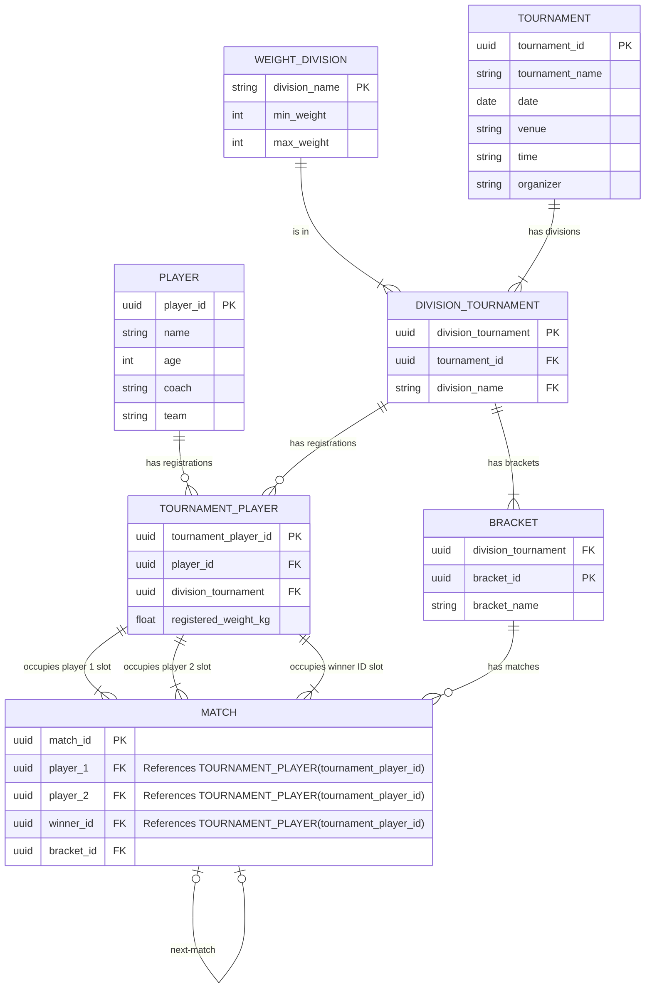

## 1. Data model

- [Entity relationship diagram](#appendix-a-entity-relationship-diagram): Mermaid transcription of the supplied **Untitled Diagram**, covering tournaments, divisions, registrations, brackets, players, and matches.

## Appendix A. Entity relationship diagram

The following conceptual ERD transcribes the supplied **Untitled Diagram**. The named shapes overlaid on unnamed rectangles are represented as the associative entities `TOURNAMENT_PLAYER` and `DIVISION_TOURNAMENT`. Attributes and primary keys follow the source; Entities without attributes in the source remain without attributes here.

### Interpretation and open questions

- Each registration connects one tournament and one player; a tournament or player may have no registrations or many. Each registration also belongs to one tournament division, which may have no registrations or many.
- `DIVISION_TOURNAMENT` associates a weight division with a tournament. The diagram places `(1,1)` beside each parent and `(1,N)` beside the association; the Mermaid relationships interpret these as one parent per association and one or more associations per parent. Confirm these minimum counts before implementing constraints.
- Each bracket belongs to one tournament division, and each match belongs to one bracket. The source shows one or more brackets per tournament division and zero or more matches per bracket.
- The registration–match relationship carries `(0,2)` near `TOURNAMENT_PLAYER` and `(0,N)` near `MATCH`. Mermaid cannot encode an upper bound of two, so the line preserves the association and its label records the source limit. Confirm whether the two refers to registered participants per match; do not implement it as a two-match limit per player without clarification.
- The match self-relationship is labeled `contains`, with a single `(0,1)` annotation and an endpoint drawn back to the match without a target ID. The optional one-to-one line is a provisional transcription; the inverse cardinality and whether this means the next match remain undefined. It does not specify how two feeder matches advance into a later round.
- The source does not define keys for `WEIGHT_DIVISION`, `DIVISION_TOURNAMENT`, `TOURNAMENT_PLAYER`, or `BRACKET`, nor foreign-key columns, score fields, or match states. `player_1`, `player_2`, and `winner` are retained as drawn; their references and nullability must be defined when creating the database schema.
