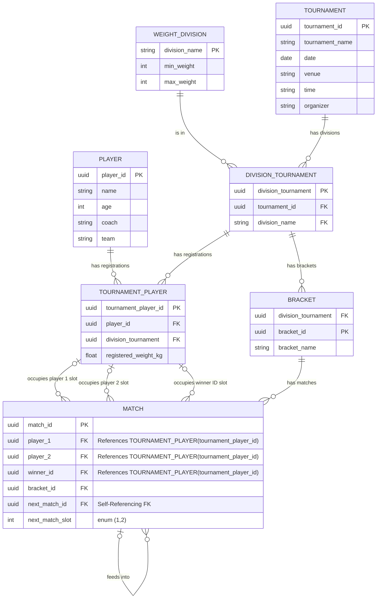

## Running the PostgreSQL container

The standalone database image uses PostgreSQL 17. It provides PostgreSQL only;
Supabase Auth and Realtime are not included. Build from the repository root:

```powershell
docker build -t dumaa-db ./database
```

Set a strong local password in the current PowerShell session, then start the
database with a named volume. Do not commit credentials:

```powershell
$env:POSTGRES_PASSWORD = Read-Host 'Local database password'
docker run --name dumaa-db --detach --publish 127.0.0.1:5432:5432 --env POSTGRES_USER=dumaa --env POSTGRES_DB=dumaa --env POSTGRES_PASSWORD --mount source=dumaa-pgdata,target=/var/lib/postgresql/data dumaa-db
Remove-Item Env:POSTGRES_PASSWORD
docker inspect --format '{{.State.Health.Status}}' dumaa-db
```

The official entrypoint applies `migrations/*.sql` alphabetically on **first
startup with an empty volume**. Rebuilding the image does not migrate an existing
volume. The named volume survives container replacement. Never remove it to apply
a migration. For a later migration, copy that specific file into the container and
apply it once with `psql -X -v ON_ERROR_STOP=1`; track applied migrations during
deployment. The initial migration is transactional and deliberately not rerunnable.

Run integration tests on a disposable database initialized from the image:

```powershell
$env:POSTGRES_PASSWORD = Read-Host 'Disposable test database password'
docker run --name dumaa-db-test --detach --env POSTGRES_USER=dumaa --env POSTGRES_DB=dumaa --env POSTGRES_PASSWORD --tmpfs /var/lib/postgresql/data dumaa-db
Remove-Item Env:POSTGRES_PASSWORD
# Wait for docker inspect to report healthy before running psql.
docker inspect --format '{{.State.Health.Status}}' dumaa-db-test
docker cp ./tests/integration/database_schema.sql dumaa-db-test:/tmp/database_schema.sql
docker exec dumaa-db-test psql -X -U dumaa -d dumaa -v ON_ERROR_STOP=1 -f /tmp/database_schema.sql
docker rm --force dumaa-db-test
```

To check persistence, create a disposable tournament record, run
`docker restart dumaa-db`, and query the record again. Connect locally with
`psql -X -h localhost -U dumaa -d dumaa`. To apply the initial migration to an
empty database without Docker:

```powershell
psql -X -v ON_ERROR_STOP=1 -d "$env:DATABASE_URL" -f database/migrations/001_initial_schema.sql
psql -X -v ON_ERROR_STOP=1 -d "$env:DATABASE_URL" -f tests/integration/database_schema.sql
```

### Implemented schema policies

- Entity and column names follow the ERD in lowercase. Tournament `time` is a
  local wall-clock time without timezone; weights use `numeric(5,2)` kilograms.
- Required text cannot be blank; age is nonnegative. Weights must be positive,
  finite, and within **inclusive** division boundaries. Adjacent divisions may
  share a boundary; administrators explicitly choose the registration division.
- Duplicate division offerings and registrations within one division are rejected.
  Multiple divisions per player and multiple brackets per division remain allowed.
- Nullable match slots support future rounds and byes. `round_number` is positive;
  advancement must go to a strictly later round in the same bracket. Each
  destination slot has at most one feeder. Gaps between round numbers are allowed.
- Registration reassignment is blocked once used in a match. Parent updates are
  validated against current registrations and match eligibility. Referenced rows
  cannot be deleted; finalized matches cannot be changed or deleted. TRUNCATE is
  blocked so it cannot bypass these checks.
- Call `SELECT public.finalize_match(match_uuid, winner_registration_uuid)` inside
  a READ COMMITTED transaction. The function records the winner and advances them
  atomically. An identical retry is a no-op; a different winner is rejected.
  All feeder matches must be finalized before finalizing their destination match.
  A populated destination slot must match its feeder winner. Deferred constraints
  verify advancement at commit, including for direct SQL writes.
- A single transaction-level advisory lock serializes writes across these tables.
  This deliberately favors correctness for the initial small workload. Writes at
  REPEATABLE READ or SERIALIZABLE isolation are rejected. Concurrent finalizations
  wait, then observe committed state; lock contention may limit future throughput.
- Winner selection is supplied by a trusted administrator. Score-derived winner
  validation, match status, automatic bye handling, seeding, audit history,
  regeneration, and correction workflows remain deferred. A one-participant match
  can be finalized explicitly as a bye; no sporting rules are inferred.
- RLS is enabled without access policies, PUBLIC privileges are revoked, and
  functions use invoker rights. Owner credentials are for migrations/testing only.
  Do not use them in browser code. Manager grants/policies, public scoreboard
  projections, Supabase integration, and generated TypeScript database types must
  follow when their actual access model and database environment are configured.

## 1. Data model

- [Entity relationship diagram](#appendix-a-entity-relationship-diagram): Mermaid transcription of the supplied **drawio Diagram**, covering tournaments, divisions, registrations, brackets, players, and matches.


## Appendix A. Entity relationship diagram

The following Entity Relationship Diagram (ERD) represents the conceptual data model for the Tournament Management System. It defines the entities, attributes, primary keys, foreign keys, and relationships required to manage players, tournaments, weight divisions, registrations, brackets, and matches.

The model is designed around a single-elimination tournament format, where administrators manage player registrations, generate brackets, record match results, and automatically advance winners to subsequent matches.

The entities TOURNAMENT_PLAYER and DIVISION_TOURNAMENT serve as associative entities that resolve relationships between players, tournaments, and weight divisions.

The diagram also represents match progression through a self-referencing relationship in the MATCH entity.



### Interpretation and relationship constraints

#### 1. Player and tournament registration

- `PLAYER` stores information about a player independently of any tournament.
- `TOURNAMENT_PLAYER` represents a player's registration in a specific tournament division.
- A player may have zero or many tournament registrations.
- Each tournament registration references exactly one player and one tournament division.
- Only administrators are authorized to create and manage player records and tournament registrations.
- Players cannot register themselves in a tournament.

#### 2. Tournament and weight division

- `TOURNAMENT` represents an organized competition.
- `WEIGHT_DIVISION` defines reusable weight categories through `division_name`, `min_weight`, and `max_weight`.
- `DIVISION_TOURNAMENT` associates a weight division with a particular tournament.
- A tournament may contain zero or many tournament divisions.
- A weight division may be associated with zero or many tournaments.
- Each tournament division references exactly one tournament and one weight division.
- A tournament division may contain zero or many player registrations.

#### 3. Player weight and division assignment

- `TOURNAMENT_PLAYER.registered_weight_kg` stores a player's recorded weight for a particular tournament registration.
- A player's recorded weight may differ between tournaments.
- The assigned weight category is determined through the relationship between `TOURNAMENT_PLAYER`, `DIVISION_TOURNAMENT`, and `WEIGHT_DIVISION`.
- The recorded weight should be validated against the minimum and maximum weight boundaries of the assigned division.
- The precise handling of weight boundaries and eligibility exceptions depends on the organization's competition rules.

#### 4. Bracket and match relationships

- Each `BRACKET` belongs to exactly one tournament division.
- A tournament division may contain zero or many brackets.
- Each `MATCH` belongs to exactly one bracket.
- A bracket may contain zero or many matches before or during bracket generation.
- Matches are organized according to a single-elimination format.
- Each match contains two participant slots, represented by `player_1` and `player_2`.
- Both participant slots reference `TOURNAMENT_PLAYER.tournament_player_id`.
- A tournament registration may appear in multiple matches throughout a tournament.
- Participant slots may initially be empty when the competitors advancing from preceding matches are not yet known.

#### 5. Match results and winner determination

- `MATCH.winner_id` references `TOURNAMENT_PLAYER.tournament_player_id`.
- A match may have zero or one recorded winner.
- Before a match result is finalized, `winner_id` remains `NULL`.
- A recorded winner must correspond to either `player_1` or `player_2` of the same match.
- A tournament registration may be recorded as the winner of multiple matches across different rounds.
- Finalizing a match result initiates the winner-advancement process.

#### 6. Match progression and self-referencing relationship

- `MATCH.next_match_id` is a self-referencing foreign key that references `MATCH.match_id`.
- `MATCH.next_match_slot` identifies the participant slot in the subsequent match that receives the advancing winner.
- `next_match_slot` accepts either `1` or `2`.
- A preceding match may advance its winner to at most one subsequent match.
- A subsequent match may receive winners from at most two preceding matches.
- The final match has no subsequent match; therefore, its `next_match_id` and `next_match_slot` are `NULL`.
- The self-referencing relationship uses Mermaid's `0..N` notation to approximate the number of preceding matches. The actual business rule limits this to at most two.
- The bracket-generation process determines advancement destinations before match results are recorded.

---

## Appendix B. Data model design rationale

This section documents the reasoning behind the current database design. It serves as a reference for future development, maintenance, and schema modifications.

### 1. Separation of PLAYER and TOURNAMENT_PLAYER

**Design decision:** Player information is stored separately from tournament registration information.

The `PLAYER` entity represents an individual competitor, while `TOURNAMENT_PLAYER` represents that competitor's participation in a particular tournament division.

This separation is necessary because a player may participate in multiple tournaments over time.

For example, a player may compete in Tournament A and Tournament B without requiring two separate player records.

Instead, the database stores:

- One record in `PLAYER` representing the individual.
- One record in `TOURNAMENT_PLAYER` for each tournament division registration.

This avoids duplicating player information and allows the system to maintain historical tournament participation.

**Key principle:** A player and a tournament registration are different concepts. A player exists independently of tournaments, while a tournament registration represents their participation in a particular competition division.

### 2. Why TOURNAMENT_PLAYER does not directly reference TOURNAMENT

**Design decision:** `TOURNAMENT_PLAYER` references `DIVISION_TOURNAMENT` instead of directly referencing `TOURNAMENT`.

The tournament associated with a registration can already be determined through the following relationship:

`TOURNAMENT_PLAYER → DIVISION_TOURNAMENT → TOURNAMENT`

Since `DIVISION_TOURNAMENT` contains `tournament_id`, adding another `tournament_id` to `TOURNAMENT_PLAYER` would duplicate information that is already obtainable through an existing relationship.

This could introduce inconsistencies if the tournament referenced by `TOURNAMENT_PLAYER` differs from the tournament referenced by its associated `DIVISION_TOURNAMENT`.

Removing the redundant foreign key reduces the risk of inconsistent relationships and simplifies the schema.

**Key principle:** Store a relationship once when it can be reliably derived through an existing foreign-key relationship.

### 3. Why WEIGHT_DIVISION and DIVISION_TOURNAMENT are separate

**Design decision:** Weight division definitions are maintained independently of tournaments.

`WEIGHT_DIVISION` defines the available weight categories and their corresponding minimum and maximum weights.

`DIVISION_TOURNAMENT` determines which of those weight categories are offered in a particular tournament.

This separation allows the same weight division to be reused across multiple tournaments without repeatedly defining its boundaries.

For example, a weight division defined as 65–70 kg may be offered in several tournaments.

Each tournament uses a separate `DIVISION_TOURNAMENT` record referencing the same `WEIGHT_DIVISION`.

This also allows administrators to configure tournament divisions independently.

**Key principle:** A weight division defines a category, while a tournament division represents that category being offered in a specific tournament.

### 4. Why registered_weight_kg belongs to TOURNAMENT_PLAYER

**Design decision:** A player's recorded tournament weight is stored in `TOURNAMENT_PLAYER` rather than `PLAYER`.

Body weight is a value that can change over time.

Storing weight only in `PLAYER` would make it difficult to preserve the weight associated with previous tournament registrations.

For example:

| Tournament | Recorded weight | Assigned division |
|---|---|---|
| Tournament A | 68 kg | 65–70 kg |
| Tournament B | 72 kg | 70–75 kg |
| Tournament C | 69 kg | 65–70 kg |

By storing weight at the registration level, the system preserves the recorded weight associated with each tournament.

The assigned weight category does not need to be duplicated in `TOURNAMENT_PLAYER` because it can already be determined through `division_tournament`.

The system can validate `registered_weight_kg` against the corresponding `WEIGHT_DIVISION.min_weight` and `WEIGHT_DIVISION.max_weight`.

Once the registration is validated and saved, the division assignment is already represented by its foreign key.

**Key principle:** Store a player's recorded tournament weight as registration-specific data, while using the existing division relationship to identify their competition category.

### 5. Why MATCH references TOURNAMENT_PLAYER instead of PLAYER

**Design decision:** Match participants and winners reference tournament registrations rather than player records directly.

The `MATCH` entity contains three foreign keys referencing `TOURNAMENT_PLAYER`:

- `player_1`: The competitor occupying the first participant slot.
- `player_2`: The competitor occupying the second participant slot.
- `winner_id`: The tournament registration identified as the winner.

This design associates match participation with a player's specific tournament registration.

Referencing `PLAYER` directly would identify the individual but would not, by itself, establish which tournament division registration the individual represents.

Using `TOURNAMENT_PLAYER` allows the system to validate that match participants belong to the tournament division associated with the match's bracket.

It also supports maintaining participation and match-result history across multiple tournaments.

**Key principle:** Match participants represent tournament registrations, not merely player identities.

### 6. Why MATCH contains next_match_id and next_match_slot

**Design decision:** Match progression is represented using a self-referencing foreign key and an advancement slot.

The system must determine where a match winner advances after a result is finalized.

Two pieces of information are necessary:

- `next_match_id`: Identifies the subsequent match.
- `next_match_slot`: Identifies whether the winner occupies `player_1` or `player_2` in that match.

For example, consider a four-player single-elimination bracket:

| Match | Participants | Next match | Next slot |
|---|---|---|---|
| M1 | Player A vs Player B | M3 | 1 |
| M2 | Player C vs Player D | M3 | 2 |
| M3 | Winner M1 vs Winner M2 | NULL | NULL |

Both M1 and M2 advance to M3, but their winners occupy different participant slots.

Without `next_match_slot`, the system would know the destination match but would not know where to place the advancing competitor.

The self-referencing relationship allows the system to represent the progression structure without requiring a separate table for each round.

**Key principle:** `next_match_id` determines where the winner advances, while `next_match_slot` determines their position in the subsequent match.

### 7. Why bracket generation and match progression are separate processes

**Design decision:** The bracket structure is established before match results are recorded.

The system follows two conceptual phases.

**Phase 1: Bracket generation**

When a bracket is generated, the system:

1. Determines the participating tournament registrations.
2. Creates the required matches and rounds.
3. Assigns initial participants to first-round matches.
4. Determines the subsequent match for each match.
5. Assigns `next_match_id` and `next_match_slot` values.
6. Leaves `winner_id` as `NULL` for matches without finalized results.
7. Leaves later-round participant slots empty until their participants are determined.

At this stage, the system knows how the bracket progresses, even though the winners are unknown.

**Phase 2: Match progression**

When an administrator finalizes a match result, the system:

1. Validates the submitted result and identifies the winner.
2. Stores the winner's `tournament_player_id` in `winner_id`.
3. Retrieves the current match's `next_match_id` and `next_match_slot`.
4. Identifies the destination match and participant slot.
5. Assigns the winner to the appropriate destination slot.
6. Persists the result and advancement atomically to maintain database consistency.

This process is repeated until the final match produces a tournament division champion.

Special cases such as byes require additional handling, but the underlying advancement structure remains applicable.

**Key principle:** Bracket generation determines where winners will advance. Match progression determines who advances through the predefined structure.

### 8. Why the match progression structure resembles a directed acyclic graph

A single-elimination bracket can be represented conceptually as a directed acyclic graph (DAG).

In this representation:

- Each match is a node.
- Each `next_match_id` relationship is a directed edge.
- Each edge points toward a subsequent match.
- Matches converge toward the final match.
- Progression cannot create cycles.

The `next_match_slot` attribute provides additional information about the destination of an advancement.

This design allows the application to traverse the bracket structure without recalculating the entire bracket whenever a match is completed.

It also separates the structural relationships between matches from the results recorded during tournament execution.

**Key principle:** The bracket structure is predefined, while match results determine which competitors move through that structure.

---

## Appendix C. Open questions and implementation constraints

The following considerations remain relevant when translating the conceptual ERD into a PostgreSQL schema and implementing application logic.

### 1. Registration constraints

- Determine whether a player may register in multiple divisions within the same tournament.
- Prevent duplicate registrations in the same tournament division.
- Determine whether player registrations can be modified after bracket generation.
- Define how withdrawals, disqualifications, and registration changes affect existing brackets.

### 2. Weight division constraints

- Define whether minimum and maximum weight boundaries are inclusive or exclusive.
- Determine whether weight divisions are standardized across all tournaments.
- Determine whether administrators can modify weight division boundaries after registrations exist.
- Define whether registration weight represents an initial declared weight or an official weigh-in measurement.
- Establish how the system handles players whose recorded weight does not satisfy their assigned division's requirements.

### 3. Bracket generation constraints

- Determine how players are initially assigned to matches.
- Define how byes are distributed and processed.
- Prevent accidental duplicate bracket generation.
- Establish whether multiple brackets may exist for the same tournament division.
- Determine whether generated brackets may be modified or regenerated after matches begin.

### 4. Match integrity constraints

The implementation must ensure that:

- `player_1` and `player_2`, when both populated, reference different tournament registrations.
- Both participants belong to the tournament division associated with the match's bracket.
- `winner_id`, when populated, references either `player_1` or `player_2`.
- A match cannot advance its winner to itself.
- A match cannot advance its winner to an earlier round or a different bracket.
- A subsequent match receives advancement from at most two preceding matches.
- Two preceding matches cannot target the same participant slot of the same subsequent match.
- A finalized match cannot advance its winner more than once.
- A destination participant slot cannot be unintentionally overwritten.

### 5. Match state and scoreboard

The current ERD does not yet explicitly model:

- Match status, such as pending, ongoing, or completed.
- Participant scores and scoring events.
- Match round number or round identification.
- Result finalization timestamps.
- Audit information about administrators modifying scores or confirming results.

These attributes or supporting entities should be introduced as their implementation requirements become finalized.

### 6. Database implementation considerations

- Use PostgreSQL `UUID` for entity identifiers.
- Consider `NUMERIC(5,2)` rather than floating-point types for recorded weights and division boundaries.
- Define foreign-key nullability according to the match and tournament lifecycle.
- Use database constraints to prevent invalid values and duplicate references where possible.
- Enforce cross-table eligibility and progression rules through appropriate transactional application logic or database procedures.
- Ensure that confirming a match result and advancing its winner are performed atomically.
- Document and test how the system handles conflicting or repeated administrative requests.
